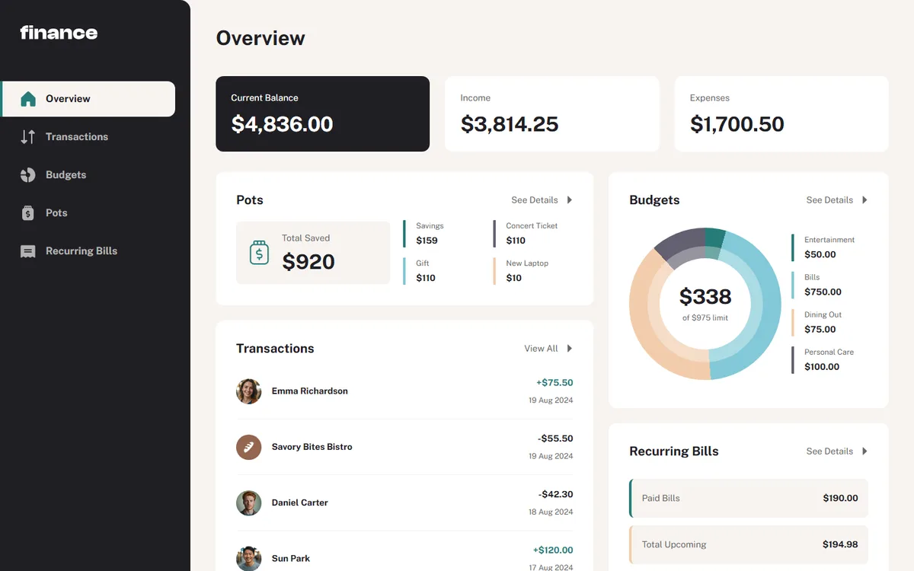

# Personal Finance

A responsive finance dashboard for managing sample budgets, savings pots, transactions, and recurring bills.

[Live demo](https://personal-finance-ui.vercel.app) · [Original challenge brief](docs/challenge-brief.md)



## Built with

React 19 · TypeScript · Vite · React Router · CSS Modules · Vitest · Playwright · axe-core

## Features

- Overview with account balances, income, expenses, savings, and recurring-bill summaries.
- Transaction search, category filtering, six sorting options, and pagination. Filters are reflected in the URL.
- Create, edit, and delete budgets and savings pots, with progress indicators and category spending.
- Deposit and withdraw from pots with insufficient-funds and overwithdrawal validation; deleting a pot returns its savings.
- Recurring-bill search, sorting, payment statuses, and summary totals.
- Responsive navigation, native dialogs, labelled forms, keyboard focus management, and status announcements.

## Implementation notes

`src/store.tsx` owns application state and persistence. `src/finance.ts` contains finance calculations; `src/pages/` separates the five route pages; `src/Modal.tsx` implements the budget and pot dialogs.

`starter-code/data.json` seeds the app. The accounting month is August 2024, following the challenge data. Budgets, pots, and balances persist in `localStorage` under `personal-finance:v1`; transactions remain read-only sample history. Invalid stored data falls back to the sample state with a warning, and unavailable storage falls back to in-session state.

## Run locally

Use Node.js 24 and npm. No application environment variables or external services are required.

```sh
npm ci
npm run dev -- --port 5197
```

Open `http://127.0.0.1:5197`.

```sh
npm run build
npm run preview
```

Vercel deploys pushes to `main`. `vercel.json` configures the `dist/` output and the fallback to `index.html` for direct route visits.

## Verification

```sh
npm test
npm run build
npm run test:e2e
```

The deployment verification on 12 October 2026 passed TypeScript, the production build, and all 13 unit tests. Existing browser tests cover filters, pagination, budget and pot CRUD, transfers, persistence, dialog keyboard behavior, responsive overflow, and automated accessibility checks.

Run the production build before browser tests. Playwright starts a preview on port 5198. On Windows it uses installed Chrome; set `PLAYWRIGHT_BROWSER_PATH` for another executable. On other operating systems, install Chromium with `npx playwright install chromium`. Browser verification does not replace testing with assistive technologies.

## Demo scope and attribution

This is a frontend portfolio demo with sample data and browser-local storage. It has no bank connections, authentication, backend, real bill payments, or cloud backup. Concurrent tabs do not automatically synchronize.

Challenge, design, and supplied assets: [Frontend Mentor](https://www.frontendmentor.io). Public Sans uses the SIL Open Font License, retained in the supplied font folders. Premium design files remain excluded from Git. The screenshot shows the implemented app; `preview.jpg` retains the supplied design reference. Detailed source design exports were not supplied, so exact matching beyond that reference cannot be verified.
